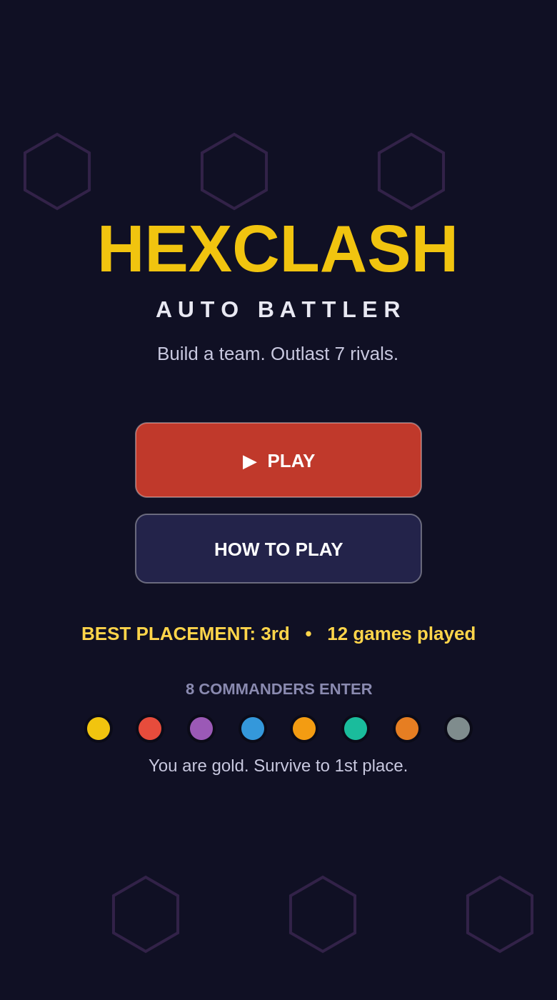
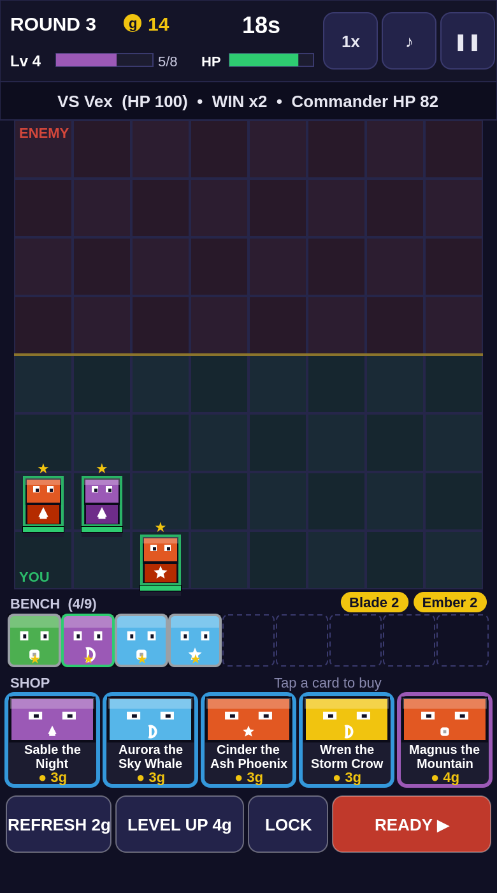
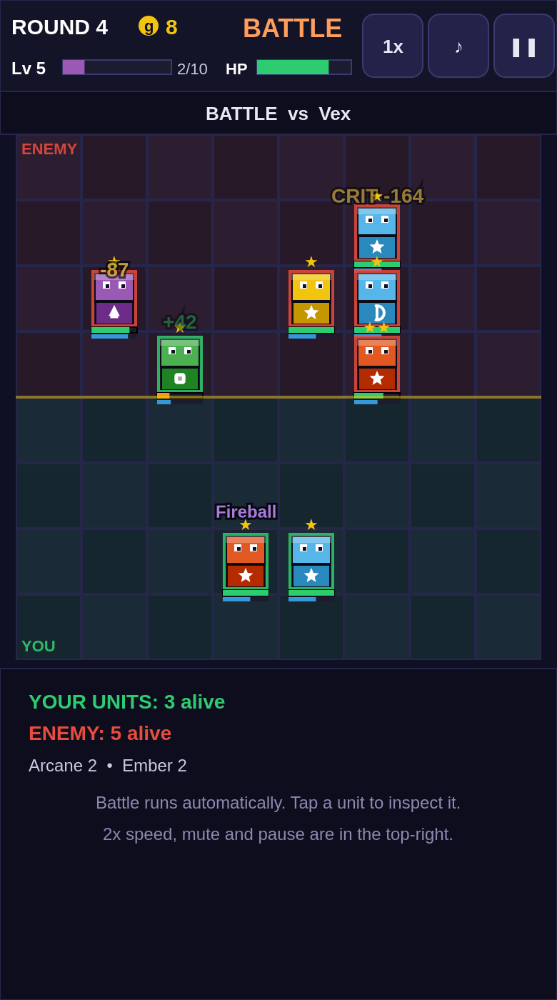
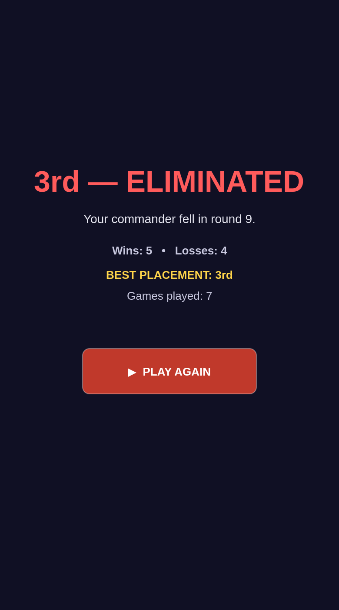

# HEXCLASH

A Magic Chess: Go Go-style **auto battler** for the browser. Build a team from a
5-card shop, stack class/faction synergies, star your heroes up, and outlast
7 rival commanders — last one standing takes **1st place**.






## How to play

**Goal.** You have 100 commander HP. Lose a battle and you take damage
(2 + surviving enemies + 1 per 5 rounds). Hit 0 HP and you're eliminated —
placement is 1st–8th depending on how many rivals are still alive.

**Shop.** Each prep phase offers 5 hero cards. Tier-1 heroes cost 1g, up to
tier-5 at 5g. Higher commander level improves the odds of high-tier cards.
Tap a card to buy it onto your bench (9 slots). **REFRESH** re-rolls for 2g;
**LOCK** keeps the same shop next round.

**Placement.** Tap a bench hero, then tap a tile on **your half** (bottom 4
rows) to deploy. You can field at most as many units as your level. Tap a
deployed hero to inspect it, sell it, or recall it to the bench.

**Synergies.** Only *unique* heroes count. Matching classes and factions on
the board grant bonuses:

| Synergy | 2 / 4 | 6 |
|---|---|---|
| Blade | +15% / +30% attack speed | +50% |
| Bow | +20% / +40% attack | +70% |
| Arcane | +25% / +50% ability damage | +100% |
| Bulwark | +20 / +40 armor | +70 |
| Ember / Frost / Verdant / Shadow / Storm | burn / slow / regen / crit / mana | stronger at 4 |

**Star upgrades.** Three copies of a hero combine into a 2-star (HP and
attack ×1.8), and three 2-stars combine into a 3-star.

**Economy.** Each round pays 5g + 1g for a win + interest (1g per 10g banked,
max 5g) + a win/loss streak bonus (up to 3g). **LEVEL UP** costs 4g for +4 XP
(+2 XP free each round; max level 9). Every 5th round is a **creep wave** —
beat it for +4g.

**Battle.** Fights run automatically: units walk, attack, gain mana, and cast
their ability at 100 mana. After 30 seconds **sudden death** drains every
unit until someone wins. Tap a unit mid-battle to inspect it.

## Controls

Tap-first, built for touch:

- **Tap a shop card** — buy it. **Tap a bench hero, then a tile** — place it.
- **Tap a board hero** — inspect, **SELL** for a refund, or recall.
- **REFRESH 2g / LEVEL UP 4g / LOCK / READY ▶** — bottom action bar.
- **Top-right:** 1x/2x battle speed, mute, pause. **READY ▶** (or the timer
  running out) starts the battle.

## Tech

Vanilla JavaScript + Canvas 2D. Zero libraries, zero network calls, zero
build step.

- `game/src/logic.js` — pure game logic (roster, shop, economy, combat);
  runs in Node and the browser, fully seeded/deterministic.
- `game/src/render.js` — Canvas 2D renderer, 390×700 logical, DPR-aware.
- `game/src/main.js` — game loop, input, timers, floating damage numbers.
- `game/src/audio.js` — tiny WebAudio sound effects, mutable.
- Best placement is saved in `localStorage` (`hexclash:best`).

## Run locally

```sh
# Just open it:
open game/index.html

# …or serve it:
npx serve game        # from this folder
```

Tests and screenshots (Node; screenshots need `node-canvas`, installed at
`node_modules/` next to `game/` — it is a dev-only tool, not part of the game):

```sh
cd game
npm test              # QA harness: 567 assertions, 0 errors
npm run screenshots   # re-renders screenshots/ from seeded game states
```
